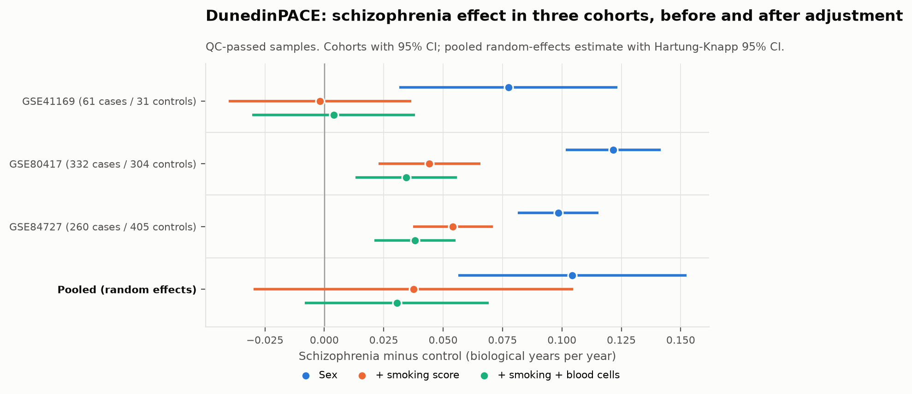
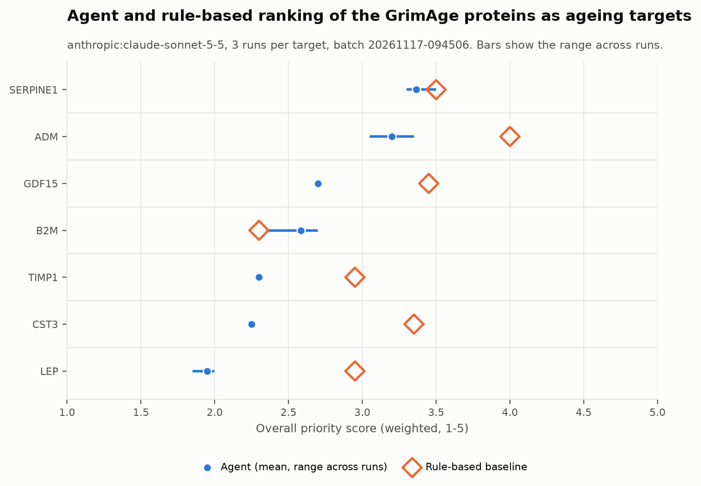

# Ageing target discovery on public data

A small target-discovery workflow for healthy ageing, built entirely on public data. It goes from a biomarker of ageing, to the proteins behind it, to which of them is worth pursuing and in which direction.

1. **Biomarker.** Six epigenetic clocks in three public blood-methylation cohorts of schizophrenia, a condition that shortens life by 10 years or more.
2. **Triage.** An LLM agent scores the seven plasma proteins behind the GrimAge clock as candidate targets, from public evidence. Code checks every fact it cites, compares it with a rule-based baseline and tests the ranking under other weightings.
3. **Direction.** Cis-Mendelian randomisation tests whether genetically higher levels of each protein shorten lifespan, and the agent reads the results as further evidence.

## Findings

**Clocks trained on mortality and pace of decline register schizophrenia; clocks trained on age do not.** In 1,396 people across three cohorts, cases were 4.8 years older on GrimAge2 and aged 0.10 biological years per year faster on DunedinPACE (pooled, both p ≈ 0.01). Most of this is smoking. After adjusting for a methylation smoking score and blood cells, DunedinPACE stayed raised in both large cohorts but not in the small, young one, so the pooled residual is not significant with three cohorts.



**Combining the cohorts needed real harmonisation.** Two cohorts keep their methylation values only in supplementary files on GEO, one recorded ages of 891 and 883 years, and one was deposited without 65,000 probes. Rerunning the other cohorts on that reduced probe set showed it shrinks the unadjusted effect by a fifth to a third, but leaves the smoking-adjusted effect unchanged.

**The agent ranked PAI-1 (SERPINE1) first, and its citations hold up.** 264 of 265 cited facts match the evidence. The top three (PAI-1, ADM, GDF15) hold under almost any weighting of the scores; first place is a trade-off between evidence about ageing, where PAI-1 leads, and evidence about drugs, where ADM leads.



**Only PAI-1 has causal support, and it points to inhibition.** Genetically higher PAI-1 meant shorter parental lifespan (Bonferroni p = 0.03). The genetic instrument behaves the same way in other PAI-1 studies, and the direction matches the long-lived Amish carriers of a SERPINE1 loss-of-function variant. The agent already proposed inhibiting PAI-1 from its biology; the MR result gave that direction causal support and moved its recommendation from consider to prioritise.

## Documents

| | Write-up | Notebook |
| --- | --- | --- |
| Clocks in three cohorts | [docs/1-clocks.md](docs/1-clocks.md) | [notebooks/1-clocks.ipynb](notebooks/1-clocks.ipynb) |
| Target triage | [docs/2-target-triage.md](docs/2-target-triage.md) | [notebooks/2-target-triage.ipynb](notebooks/2-target-triage.ipynb) |
| Causal direction | [docs/3-causal-direction.md](docs/3-causal-direction.md) | [notebooks/3-causal-direction.ipynb](notebooks/3-causal-direction.ipynb) |
| How it got here | [docs/development-notes.md](docs/development-notes.md) | |

The notebooks display the results; the full agent assessments are in [results/targets/report.md](results/targets/report.md).

## Run it

Requires Docker.

```bash
docker compose build
docker compose run --rm py pytest -q
docker compose run --rm py python -m agetarget clocks    # the three cohorts; about 5 GB from GEO the first time
docker compose run --rm py python -m agetarget pool
docker compose run --rm py python -m agetarget assess    # checks and ranks the latest agent batch, no LLM calls
docker compose up py                                     # Jupyter at http://127.0.0.1:8888, for the notebooks
```

A new batch of agent assessments, `python -m agetarget agent`, needs an LLM key in `.env` (see `.env.example`: Anthropic, OpenAI or a local model). The Mendelian randomisation runs in R in a second container; see [mr/README.md](mr/README.md).
