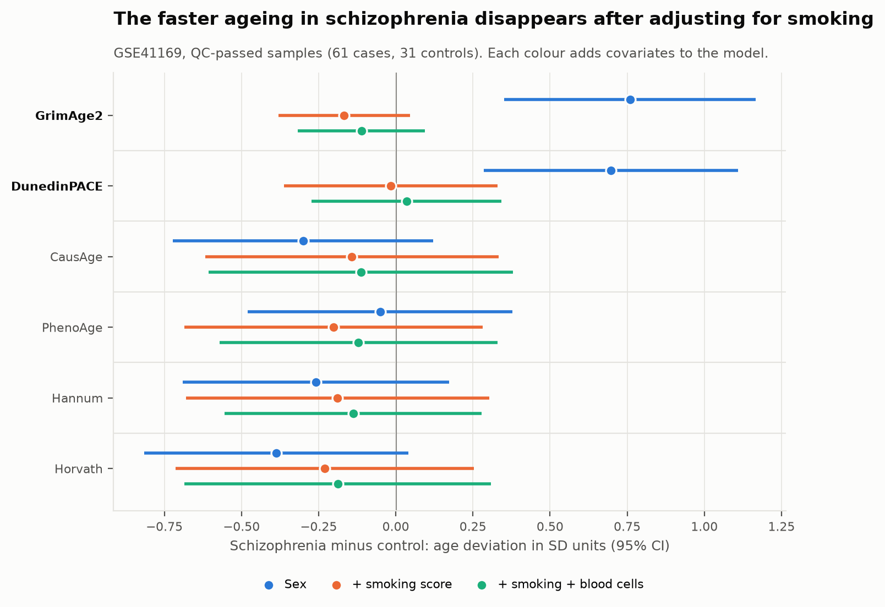
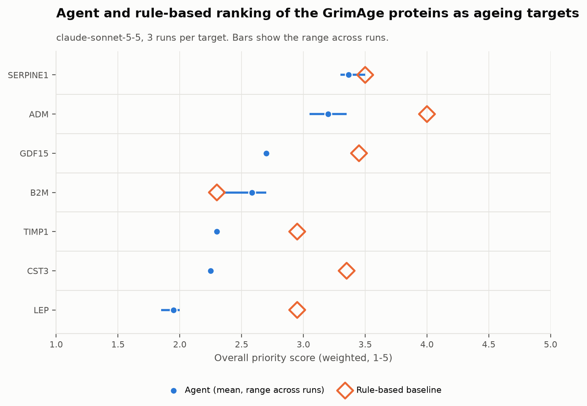

# Ageing clock benchmark

Epigenetic clocks are often treated as interchangeable measures of "biological age". This small project runs six published clocks on one public blood-methylation dataset to see where they agree, where they don't, and whether they register a condition linked to shorter life. The clocks are Horvath, Hannum, PhenoAge, GrimAge2, DunedinPACE and CausAge, run with [Biolearn](https://bio-learn.github.io/).

The dataset is GSE41169: whole blood on the Illumina 450K array, 62 people with schizophrenia and 33 controls.

## Result

Schizophrenia showed faster ageing on GrimAge2 (+4.3 years) and DunedinPACE (+7%), but not on the other four clocks. Both effects disappeared after adjusting for a methylation-based smoking score. This reproduces the result Shirai et al. (2024) reported for the same dataset. Larger cohorts still show a residual effect, which a sample of 95 is not powered to detect.



*Schizophrenia minus control, in SD units of age deviation (95% CI). Blue: adjusted for sex only. Orange: plus a methylation smoking score. Green: plus blood cell proportions. QC-passed samples.*

The full write-up, with methods and the literature comparison, is in [WRITEUP.md](WRITEUP.md).

| Figure | Shows |
| --- | --- |
| `results/fig1_predicted_vs_age.png` | Each clock against chronological age |
| `results/fig2_deviation_correlation.png` | How the clocks' age deviations correlate |
| `results/fig3_case_control_effect.png` | Effect of schizophrenia on each clock |
| `results/fig4_adjustment_effect.png` | That effect after adjusting for smoking and blood cells |

## Part 2: agentic target annotation

GrimAge is built from methylation surrogates of seven plasma proteins (ADM, B2M, cystatin C, GDF15, leptin, PAI-1, TIMP-1). `notebooks/target_ranking.ipynb` asks an LLM agent to assess them as candidate targets for healthy ageing, then checks its work:

- **Evidence is gathered without an LLM** from Open Targets, UniProt and Europe PMC, and cached in `targets/evidence/`.
- **The agent reads that evidence through tools** and scores ageing relevance, mechanism, tractability, safety and clinical precedence. It must cite the facts behind every score and list claims from its own knowledge separately.
- **Every citation is checked against the evidence.** The agent is also compared with a rule-based baseline and run several times to measure stability.



*Overall priority score per protein: agent mean with range across three runs (blue), rule-based baseline (orange diamond). Latest run, with the MR evidence from part 3: 264 of 265 cited facts matched the evidence.*

The agent works with Anthropic, OpenAI or a local model (e.g. Ollama): copy `.env.example` to `.env` and fill in one option. Details and results: part 2 of [WRITEUP.md](WRITEUP.md).

## Part 3: Mendelian randomisation

The agent in part 2 could not say whether to inhibit or activate most proteins. Part 3 tests whether genetically higher levels of each protein cause shorter lifespan, more frailty or faster GrimAge ageing, using cis-Mendelian randomisation on public GWAS summary statistics (R, in `mr/`).

- **Only PAI-1 (SERPINE1) showed a causal signal:** genetically higher PAI-1 meant shorter parental lifespan (p = 0.0015, Bonferroni-significant across 20 tests). The direction replicated in two other PAI-1 studies. Colocalisation was inconclusive because the lifespan GWAS is weak at this locus.
- **The other four testable proteins were null;** B2M and TIMP1 had no usable instruments.
- **The agent now reads these results** through an eighth tool. It changed its proposal for PAI-1 from "unclear" to "inhibit", recommended prioritising it in two of three runs, and lowered its scores for proteins with well-powered null results.

Details: part 3 of [WRITEUP.md](WRITEUP.md). Setup and scripts: [mr/README.md](mr/README.md).

## Run it

Requires Docker.

```bash
docker compose build                       # once
docker compose run --rm clocks pytest -q   # optional: run the tests
docker compose up                          # open the http://127.0.0.1:8888 link it prints
```

Then run `notebooks/clock_benchmark.ipynb` (part 1) or `notebooks/target_ranking.ipynb` (part 2) top to bottom. The dataset downloads from GEO on the first run.

Part 3 runs in a second container with RStudio and needs a free OpenGWAS token in `.env`. `docker compose up` starts it at http://127.0.0.1:8787; run the scripts in `mr/` in order, then the part 2 notebook picks up their results. See [mr/README.md](mr/README.md).

## References

- Moqri M, et al. (2023) Biomarkers of aging for the identification and evaluation of longevity interventions. *Cell* 186:3758–3775. [doi:10.1016/j.cell.2023.08.003](https://doi.org/10.1016/j.cell.2023.08.003)
- Shirai T, et al. (2024) Meta-analyses of epigenetic age acceleration and GrimAge components of schizophrenia or first-episode psychosis. *Schizophrenia* 10:108. [doi:10.1038/s41537-024-00531-8](https://doi.org/10.1038/s41537-024-00531-8)
- Caspi A, et al. (2023) Accelerated pace of aging in schizophrenia: five case-control studies. *Biological Psychiatry* 95:1038–1047. [doi:10.1016/j.biopsych.2023.10.023](https://doi.org/10.1016/j.biopsych.2023.10.023)
