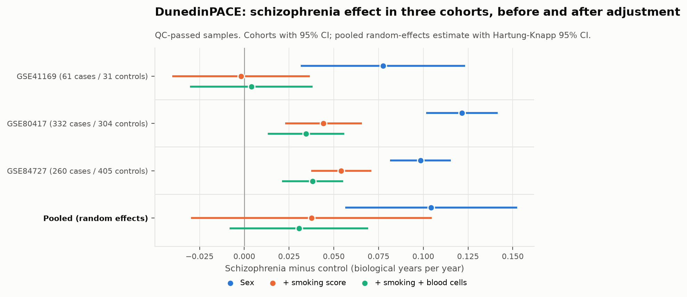

# Ageing clocks in schizophrenia: what one small blood-methylation cohort can and cannot show

## Summary

Six published epigenetic clocks run on 95 blood samples (GSE41169: 62 people with schizophrenia, 33 controls) disagreed sharply. The four clocks that estimate age directly from methylation saw no difference between groups. The two clocks built on mortality risk and pace of decline, GrimAge2 and DunedinPACE, showed clearly faster ageing in schizophrenia (+4.3 years and +7% per year). Both effects disappeared after adjusting for a methylation-based smoking score. This reproduces the per-cohort result reported for the same dataset by Shirai et al. (2024), who used different software and a different smoking proxy. Larger cohorts in that study and in Caspi et al. (2024) still show a residual effect after smoking adjustment, which a sample of 95 is not powered to detect.

## Question

Published epigenetic clocks are often treated as interchangeable measures of "biological age". I wanted to see where they agree and where they don't, and which of them register a condition linked to shorter life expectancy. Schizophrenia shortens life by 10 years or more, and people with schizophrenia smoke far more than average, which makes it a good test of whether a clock measures ageing or exposure.

## Data and methods

- **Dataset.** GSE41169: whole blood, Illumina 450K array (485,577 CpGs), 95 samples from the Netherlands. Ages 18–65 (median 29); 67 men, 28 women. Cases were older than controls (median 31.5 vs 27 years) and more often male (74% vs 64%). Missing values were rare (median 0.13% per sample).
- **Clocks.** Horvath and Hannum (trained on chronological age), PhenoAge (clinical phenotype), GrimAge2 (time to death), DunedinPACE (pace of decline, in biological years per calendar year) and CausAge (CpGs with putative causal links to ageing). All were run with Biolearn inside a Docker container. Package versions are in `results/environment.txt`.
- **Age deviation.** The residual of each clock regressed on chronological age. This removes each clock's bias and constant offset and makes deviations comparable across clocks.
- **Group comparison.** Case minus control difference in age deviation from linear models adjusted for sex, with Benjamini–Hochberg correction across clocks. I then added a methylation smoking score (Biolearn's McCartney predictor) and estimated blood cell proportions (B cells, CD4 and CD8 T cells and monocytes, with neutrophils as the reference).
- **Quality control.** Methylation-predicted sex was compared with recorded sex. Two samples did not match and were excluded in the QC-passed analysis. GSM1009696 was also excluded as an outlier. Four clocks placed it 14–21 years younger than its recorded age of about 34, which points to a recording error, although its sex matched. Every result is reported with and without these three samples.

## Findings

### 1. The clocks track age to very different degrees

| Clock | r with age | Mean absolute error | Behaviour in this cohort |
| --- | --- | --- | --- |
| Horvath | 0.93 | 3.0 years | Close to chronological age |
| Hannum | 0.93 | 3.0 years | Close to chronological age |
| PhenoAge | 0.91 | 5.6 years | About 5 years below chronological age |
| CausAge | 0.92 | 6.8 years | About 7 years below chronological age |
| GrimAge2 | | | Mean prediction 46 years, well above the cohort's ages |
| DunedinPACE | | | Mean pace 0.99 (range 0.69–1.35) |

GrimAge2 was trained in older cohorts and overshoots in a group this young. Tracking chronological age closely is not the goal of an ageing biomarker. Moqri et al. (2023) call this the "paradox of biomarkers": the better a clock predicts age, the less it tends to say about health. The residual-based comparisons below are unaffected by these offsets.

### 2. The clocks disagree about what matters

Disagreement shows up in two places. On individuals, the outlier GSM1009696 was flagged by the four clocks that read age purely from methylation. GrimAge2 did not flag it, because it takes recorded age as an input, and DunedinPACE did not, because it estimates rate, not age. On the group question, the clocks split cleanly by how they were trained, as the next table shows. Figure 2 gives the full correlation matrix of age deviations.

### 3. Schizophrenia shows faster ageing only on mortality and pace clocks

Adjusted for sex, all 95 samples:

| Clock | Schizophrenia minus control | p |
| --- | --- | --- |
| GrimAge2 | +4.3 years | 0.0006 |
| DunedinPACE | +0.07 (7% faster) | 0.002 |
| Horvath | −1.5 years | 0.08 |
| CausAge | −1.4 years | 0.12 |
| Hannum | −1.3 years | 0.17 |
| PhenoAge | −0.5 years | 0.62 |

The effects of GrimAge2 and DunedinPACE are large for a sample this size (Cohen's d 0.80 and 0.67 with the outlier removed). In the QC-passed set they barely change (+4.5 years, p = 0.0004; +0.08, p = 0.001).

### 4. Both effects disappear after adjusting for smoking

People with schizophrenia had much higher methylation smoking scores (mean 4.39, SD 1.37) than controls (3.14, SD 0.93). After adding the score to the model, GrimAge2 fell to −0.6 years (p = 0.38) and DunedinPACE to 0.00 (p = 0.86). In the QC-passed set they were −1.0 years (p = 0.13) and 0.00 (p = 0.92). Adding blood cell proportions changed nothing further. Figure 4 shows the three models side by side in SD units.

## How this compares with the literature

- **Clocks trained on chronological age.** These show no acceleration in schizophrenia in larger studies (McKinney et al. 2017) and, if anything, slower ageing (Wu et al. 2021). This matches the small negative estimates here.
- **Mortality clocks.** These run up to 5 years older in schizophrenia, largely because of smoking and smoking-related protein surrogates (Higgins-Chen et al. 2020). Caspi et al. (2024) found the GrimAge difference largely disappeared after smoking adjustment. This matches what I found for GrimAge2.
- **The same dataset.** Shirai et al. (2024) included GSE41169 in a seven-cohort meta-analysis. Adjusting for GrimAge's own smoking estimate (DNAmPACKYRS), they reported no schizophrenia effect in this cohort for GrimAge2 (standardised β = −0.001, p = 0.98) or DunedinPACE (β = 0.016, p = 0.80). I reproduced that conclusion with different software and a different smoking proxy.
- **Larger cohorts.** In the three large cohorts of the same study (n ≈ 640–680 each), DunedinPACE and GrimAge2 stayed elevated after smoking adjustment (DunedinPACE β = 0.17–0.22, all p < 10⁻⁵). Caspi et al. (2024) pooled five cohorts and 3,565 people. Their unadjusted DunedinPACE effect was 0.65 SD, almost exactly the d = 0.67 here, and an effect of 0.22 SD remained after adjusting for cells and smoking.

The most likely reading is a power problem, not a contradiction. Detecting a residual effect of 0.25 SD with 80% power takes about 250 people per group, and this cohort has 33 controls. In Shirai's analysis, the standard error of the DunedinPACE effect in GSE41169 was about twice that in the large cohorts.

## Why the clocks disagree

What a clock was trained to predict decides what it sees:

- **Horvath and Hannum** learned chronological age, so they capture little of the variation that matters for health.
- **GrimAge2** learned time to death through surrogates of plasma proteins and smoking pack-years. It reacts strongly to smoking, which is exactly the exposure that differs most between these groups.
- **DunedinPACE** learned the pace of physiological decline. It is less tied to smoking than GrimAge, which may be why larger studies still find an effect after adjustment.

Smoking here is probably part of the causal path from schizophrenia to faster ageing, not just a nuisance variable. People with schizophrenia who smoke really do show older-looking methylation. What this cohort cannot show is acceleration beyond what smoking accounts for.

## Limitations

- **One small cohort.** It is cross-sectional and young (median age 29), so accelerated ageing has had little time to accumulate.
- **Smoking is estimated, not measured.** No self-reported smoking or medication data were available. The smoking score is itself derived from methylation and probably shares CpGs with GrimAge's smoking component, so adjusting for it partly removes the clock's own signal.
- **Different smoking proxies give different results.** The McCartney score used here, the Elliott score (Caspi) and DNAmPACKYRS (Shirai) will not remove signal to the same degree.
- **Blood mainly reports immune ageing.** Adjusting for cell proportions may remove some genuine ageing signal along with confounding.
- **Some CpGs were imputed**, because the 450K array lacks a few CpGs that some clocks use.

## What I would do next

- **Run the same notebook on a larger cohort**, such as GSE84727 or GSE80417. The aim is to see whether the residual DunedinPACE effect appears at scale, as it does in Shirai et al. and Caspi et al. Part 4 does this.
- **Compare smoking proxies directly.** Test McCartney, DNAmPACKYRS and a self-reported measure where available, and see how much each one removes.
- **Add the GrimAge protein surrogates** to see which components carry the effect. Shirai et al. point to adrenomedullin, beta-2 microglobulin, cystatin C and PAI-1.

## References

- Moqri M, et al. (2023) Biomarkers of aging for the identification and evaluation of longevity interventions. *Cell* 186:3758–3775. [doi:10.1016/j.cell.2023.08.003](https://doi.org/10.1016/j.cell.2023.08.003)
- Shirai T, et al. (2024) Meta-analyses of epigenetic age acceleration and GrimAge components of schizophrenia or first-episode psychosis. *Schizophrenia* 10:108. [doi:10.1038/s41537-024-00531-8](https://doi.org/10.1038/s41537-024-00531-8)
- Caspi A, et al. (2024) Accelerated pace of aging in schizophrenia: five case-control studies. *Biological Psychiatry* 95(11):1038–1047. [doi:10.1016/j.biopsych.2023.10.023](https://doi.org/10.1016/j.biopsych.2023.10.023)
- Higgins-Chen AT, et al. (2020) Schizophrenia and epigenetic aging biomarkers: increased mortality, reduced cancer risk, and unique clozapine effects. *Biological Psychiatry*. [doi:10.1016/j.biopsych.2020.01.025](https://doi.org/10.1016/j.biopsych.2020.01.025)
- McKinney BC, et al. (2017) DNA methylation age is not accelerated in brain or blood of subjects with schizophrenia. *Schizophrenia Research*. [doi:10.1016/j.schres.2017.09.025](https://doi.org/10.1016/j.schres.2017.09.025)
- Wu X, et al. (2021) Epigenetic age acceleration was delayed in schizophrenia. *Schizophrenia Bulletin*. [doi:10.1093/schbul/sbaa164](https://doi.org/10.1093/schbul/sbaa164)

# Part 2: an LLM agent that annotates and ranks candidate targets

## Summary

An LLM agent (Claude Sonnet, via the Anthropic API) assessed the seven plasma proteins behind GrimAge as candidate targets for healthy ageing. It scored each protein on five dimensions from cached public evidence, and it had to cite the facts behind every score. All 286 cited facts in the final run matched the evidence exactly. PAI-1 (SERPINE1) and adrenomedullin (ADM) ranked highest, but their order changed between sessions, and no protein was recommended for prioritisation. A first version of the instructions produced correct facts but weaker reasoning. Reviewing its output, tightening the instructions and re-running fixed four specific weaknesses.

## Design

The agent is kept to the one task code cannot do, weighing incomplete evidence, and everything around it is deterministic:

1. **Evidence, without an LLM.** For each protein:
   - Open Targets: tractability, safety liabilities, clinical candidates, disease associations;
   - UniProt: function and location;
   - Europe PMC: publication counts.

   Results are cached as JSON and flattened into facts with stable IDs (e.g. `clinical.max_stage = 2`), so every run and every model sees identical evidence.
2. **The agent** reads the evidence through seven tools and submits a fixed-format assessment:
   - five scores of 1–5 (ageing relevance, mechanism, tractability, safety, clinical precedence), each with the fact IDs and values it relies on;
   - claims from its own knowledge, listed separately;
   - a proposed direction of modulation (inhibit, activate or unclear);
   - a recommendation (prioritise, consider or deprioritise).

   Submissions that break the format are rejected and sent back.
3. **Checks, in code:**
   - every cited value is compared with the evidence;
   - the scores are compared with a rule-based baseline;
   - each protein is assessed three times, to measure how much the scores vary between runs.
4. **The report** is assembled by code from the structured assessments, so no unchecked text is added after the checks.

Two evidence problems were fixed before any agent run:

- **Ambiguous symbols.** Searching publications by gene symbol inflated the counts for ambiguous symbols such as "ADM" and "LEP", so searches use curated protein names instead.
- **Popularity bias.** Ageing relevance is measured as the *share* of a protein's papers about ageing or senescence, not the raw count. Otherwise the most studied protein wins.

## Results

| Rank | Protein | Agent score, mean (range over 3 runs) | Baseline | Recommendations across runs |
| --- | --- | --- | --- | --- |
| 1 | SERPINE1 (PAI-1) | 3.37 (3.30–3.50) | 3.50 | consider 3 |
| 2 | ADM | 3.10 (3.05–3.20) | 4.00 | consider 3 |
| 3 | CST3 (cystatin C) | 2.85 (2.55–3.00) | 3.35 | deprioritise 2, consider 1 |
| 4 | B2M | 2.70 | 2.30 | consider 3 |
| 4 | GDF15 | 2.70 | 3.45 | consider 3 |
| 6 | TIMP1 | 2.50 | 2.95 | deprioritise 2, consider 1 |
| 7 | LEP (leptin) | 2.30 | 2.95 | deprioritise 3 |

- **Citations: 286 of 286 cited facts match the evidence.** The agent cited no facts that don't exist and misquoted no values.
- **Evidence and own knowledge stayed separate.** The agent named drugs it knew of but the tools did not list, and explicitly did not score them: ponsegromab (anti-GDF15, phase 2) and metreleptin (approved, acting on the leptin receptor). It discounted PROTAC evidence for secreted proteins.
- **It was stricter on safety than the baseline.** It followed the rule that no recorded liabilities is "absence of data, not evidence of safety"; the baseline gives a high score whenever none are listed.
- **The scores were stable, the recommendations less so.** Within a batch, overall scores varied by at most 0.45. The top-two order changed between sessions, though: in an earlier batch ADM came first. The recommendations for CST3 and TIMP1 differed between runs. Ranked scores were more reproducible than categorical labels.
- **Five of seven proteins named the evidence that would settle the direction of modulation:** Mendelian randomisation. That is the next part of this project.

## What review of version 1 found, and what version 2 changed

The first version also cited facts correctly (254 of 254, checked against the evidence it was shown). Reading its reports turned up four reasoning problems the automated checks could not see:

| Version 1 problem | Version 2 change | Effect |
| --- | --- | --- |
| The rationale text was not checked, only the cited values | Every factual statement must come from a cited fact or be listed as the model's own knowledge | More claims are labelled as own knowledge |
| A clock-level finding (the GrimAge difference explained by smoking) was applied to B2M | The context now says exactly what each finding applies to; the agent is told not to transfer findings | It now states it will not apply clock-level results to individual proteins |
| A conflict between sources went unnoticed (PAI-1: "advanced clinical" tractability vs a phase 1 drug) | A required list of conflicts between sources, with which one was relied on | Two or three conflicts flagged per protein, including this one |
| An unclear recommendation ("worth considering to prioritise") | The recommendation must be stated in the summary's last sentence | Every summary ends with a clear recommendation |

Version 2 was more conservative and more consistent:

| Protein | Version 1 recommendations | Version 2 recommendations |
| --- | --- | --- |
| SERPINE1 | prioritise 2, consider 1 | consider 3 |
| LEP | consider 2, deprioritise 1 | deprioritise 3 |
| CST3 | consider 2, deprioritise 1 | deprioritise 2, consider 1 |

GDF15 dropped (3.00 → 2.70) once its null project finding was read correctly. The model and the database evidence were the same in both versions; only the instructions and the wording of the project context changed.

## Failures worth knowing about

- **Silent truncation.** The stricter instructions made answers longer than the 2,048-token output limit. Truncated submissions arrived without their last fields and were rejected without the cause being stated. The model then dropped its largest field, the scores, to fit, and one assessment failed after 13 attempts. The fix:
    - raise the limit;
    - read the provider's stop reason and tell the model when its answer was cut off;
    - put the decision fields first in the format.

  The diagnostics table (rejections, nudges and repeated tool calls per run) found the cause.
- **A checker that was too strict.** Early citation checks reported "mismatches" that were formatting differences, never wrong values:
    - empty lists;
    - quotes shortened with "...", or with a sentence skipped;
    - lists cited as a comma-separated string;
    - JSON passed as text;
    - UniProt reference tags removed from a quote.

  The checker was changed to normalise formats, but it still rejects any value that isn't in the evidence, and tests cover both directions.
- **Evidence drift.** Re-checking the version 1 runs the next day reported 18 failing citations. All were the project context: version 1 had quoted it correctly, but the settings now held the version 2 wording. Citations are now checked against the facts each run was actually shown, read back from its saved trace, and facts that have changed since are flagged separately. Checking an old run against today's evidence answers a different question.

## Limitations

- **The seven proteins were not discovered by the agent.** They come from a published clock, so this tests annotation and triage, not discovery.
- **The evidence is narrow:** three public sources, a sparse safety dataset, and no causal genetic evidence yet.
- **Prose is only partly checked.** Cited values are verified, but whether a sentence fairly represents a fact is not.
- **Some results vary between runs and sessions:** the top-two order and some recommendations.

## Next

Part 3 adds the missing causal evidence. Cis-Mendelian randomisation with public pQTL and GWAS summary statistics tests whether genetically higher protein levels cause faster ageing. The results become a further evidence tool, so the agent can base its inhibit/activate decision on causal data.

# Part 3: Mendelian randomisation of the GrimAge proteins, and what it changed in the agent

## Summary

Part 2's agent could not say whether to inhibit or activate most of the seven GrimAge proteins, and five of its seven assessments named Mendelian randomisation (MR) as the evidence that would decide it. Part 3 ran that analysis with public summary statistics and gave the results to the agent as a new evidence tool.

Five of the seven proteins had usable genetic instruments. One result survived correction for 20 tests: genetically higher PAI-1 (SERPINE1) was associated with shorter parental lifespan (p = 0.0015, Bonferroni p = 0.03). The instrument's direction replicated in two other PAI-1 studies but not in GrimAge's methylation estimate of PAI-1. Colocalisation was inconclusive, because the lifespan GWAS has only a weak signal at the locus. With the MR results available, the agent changed its proposal for PAI-1 from "unclear" to "inhibit", recommended prioritising it in two of three runs, and lowered its scores for proteins with well-powered null results.

## Design

Two-sample cis-MR: genetic variants near a protein's own gene that change its plasma level act as a natural experiment for raising or lowering the protein. Everything ran in R (TwoSampleMR, ieugwasr, coloc) inside a second Docker container with RStudio, on GWAS summary statistics hosted by OpenGWAS. Every API call is cached, so reruns are free and reproducible.

**Exposures**, one protein GWAS each:

| Protein | Study | Platform | n | Cis instruments |
| --- | --- | --- | --- | --- |
| ADM | Folkersen 2020 (SCALLOP) | Olink | 21,758 | 2 |
| B2M | Suhre 2017 | SomaScan | ~1,000 | 0 |
| CST3 (cystatin C) | UK Biobank serum biochemistry | clinical assay | 437,846 | 6 |
| SERPINE1 (PAI-1) | Pietzner 2020 | SomaScan | 10,708 | 1 |
| GDF15 | Folkersen 2020 (SCALLOP) | Olink | 21,758 | 2 |
| LEP (leptin) | Folkersen 2020 (SCALLOP) | Olink | 21,758 | 1 |
| TIMP1 | Suhre 2017 | SomaScan | ~1,000 | 0 |

**Outcomes:**

- parental lifespan: Pilling 2017, 389,166 UK Biobank participants;
- frailty index: Atkins 2021, 175,226 people;
- GrimAge acceleration: McCartney 2021, 34,467 people, two entries in OpenGWAS.

**Method:**

- **Instruments:** p < 5 × 10⁻⁸, clumped, and within 1 Mb of the protein's gene. Restricting to cis variants makes it more likely that the variant acts through the protein itself.
- **Estimators:** Wald ratio for one variant, inverse-variance weighted (IVW) for more. Egger and weighted median were added from three variants, and heterogeneity was tested from two.
- **Multiple testing:** Bonferroni correction over the 20 primary tests (5 proteins × 4 outcomes).
- **Direction check:** what a positive beta means depends on how each GWAS was coded. I checked each outcome against a variant of known effect: APOE ε4 (rs429358) has a positive beta in the parental-lifespan GWAS, so there positive means shorter life.

## Results

### Only PAI-1 showed a causal signal

| Protein | Variants | Effect on parental lifespan | p |
| --- | --- | --- | --- |
| SERPINE1 | 1 | shorter (b = +0.070) | 0.0015 (Bonferroni 0.03) |
| LEP | 1 | b = +0.045 | 0.14 |
| ADM | 2 | b = +0.015 | 0.30 |
| GDF15 | 2 | b = +0.009 | 0.69 |
| CST3 | 6 | b = −0.001 | 0.82 |

No other test of any protein on frailty or GrimAge acceleration reached p < 0.1. B2M and TIMP1 could not be tested: their only pQTL source here has about 1,000 people and gave no cis instruments.

The PAI-1 direction matches the Amish carriers of a loss-of-function SERPINE1 variant, who live longer than non-carriers (Khan et al. 2017).

### Follow-up of the PAI-1 instrument

The instrument is rs2227631, a promoter variant 1 kb upstream of SERPINE1, with F = 61. Its G allele lowers PAI-1.

- **Replication across protein studies.** The G allele lowered PAI-1 in Gilly 2020 (β = −0.10, p = 0.012) and, non-significantly, in Sun 2018 (β = −0.04, p = 0.15).
- **No effect on GrimAge's methylation estimate of PAI-1** (McCartney 2021: β = +0.06, p = 0.45, n = 34,448). The surrogate does not follow the genetics of the measured protein. This fits part 1, where GrimAge's signal tracked smoking.
- **PheWAS (p < 10⁻⁵, 9 associations):**
  - PAI-1 itself, and tissue plasminogen activator, which is in the same pathway;
  - expression of SERPINE1 and four other genes;
  - small effects on pulse rate and red-cell count.

  There were no associations with bleeding, lipids or BMI.

### Colocalisation is inconclusive

Colocalisation tests whether one shared variant drives both the PAI-1 signal and the lifespan signal (H4), or whether two different variants in linkage disequilibrium do (H3). Within ±250 kb of SERPINE1 (2,290 variants):

| H0 no signal | H1 PAI-1 only | H2 lifespan only | H3 two variants | H4 one shared variant |
| --- | --- | --- | --- | --- |
| 0.00 | 0.83 | 0.00 | 0.04 | 0.13 |

- **If there is a shared variant, it is the instrument:** rs2227631 carries 94% of the H4 probability.
- **The lifespan GWAS has no strong signal at this locus.** Its strongest variant in the window, rs4268055 (70 kb upstream), reaches only p = 6 × 10⁻⁴. A signal this weak cannot push PP.H4 above the usual 0.8.
- **The window matters.** A ±1 Mb window first gave PP.H3 = 0.19. That came from a lifespan signal (p = 4 × 10⁻⁵) outside the ±250 kb window, so it did not belong to SERPINE1.

The MR result is Bonferroni-significant and directionally replicated, but colocalisation is underpowered, not contradictory.

### GDF15: a null hiding a disagreement

GDF15's two cis variants disagree with each other on three of the four outcomes (heterogeneity Q p = 0.008 for parental lifespan, 0.001 for both GrimAge entries). Its null IVW estimate is therefore an average of variants pulling in different directions, not two variants agreeing on no effect. One possibility is an assay artefact: a protein-altering variant can change antibody binding in an immunoassay without changing the protein level. Whether one of the two instruments is a missense variant is an open question.

## What the MR evidence changed in the agent

The causal results became an eighth evidence tool, `get_causal_evidence`, which returns short, citable facts per protein:

- the instruments and their F-statistics;
- the MR estimate for each outcome, with Bonferroni p;
- a direction, given only when the result is significant;
- heterogeneity checks, colocalisation, replication and the top PheWAS traits.

Proteins without instruments are reported as "not tested", not as null. The prompt gained one rule. A significant MR result is the strongest evidence available for ageing relevance and direction. It is weighed with colocalisation (PP.H4 > 0.8 supports it, PP.H3 > 0.8 argues against it). A null is weak evidence against, and "not tested" is no evidence either way.

Same model, same evidence otherwise, three runs per protein:

| Protein | Version 2 score | Version 3 score, with MR | Version 3 recommendations | Version 3 modulation |
| --- | --- | --- | --- | --- |
| SERPINE1 | 3.37 | 3.37 | prioritise 2, consider 1 | inhibit |
| ADM | 3.10 | 3.20 | consider 3 | unclear |
| GDF15 | 2.70 | 2.70 | consider 3 | unclear |
| B2M | 2.70 | 2.58 | consider 3 | unclear |
| TIMP1 | 2.50 | 2.30 | deprioritise 2, consider 1 | unclear |
| CST3 | 2.85 | 2.25 | deprioritise 3 | unclear |
| LEP | 2.30 | 1.95 | deprioritise 3 | unclear |

- **SERPINE1 gained a direction and a stronger recommendation.** Its overall score stayed the same: ageing relevance and mechanism rose to 4, but safety stayed at 2 because inhibiting PAI-1 carries a bleeding risk. The agent called colocalisation inconclusive and replication mixed. It noted that frailty and GrimAge were null and that one instrument cannot test pleiotropy. One run in three still said "consider".
- **Well-powered nulls were penalised.** CST3, with six instruments from 438,000 people, dropped most (2.85 → 2.25). LEP dropped less, and its null rests on a single variant.
- **Untested proteins were not penalised for the missing data.** B2M and TIMP1 listed the missing MR among their key uncertainties, and their scores barely moved.
- **Citations: 264 of 265 matched.** The one mismatch was a reformatting: the agent condensed a list of MR results into one line, with correct values.
- **An unchecked claim was right.** The agent wrote that GDF15's instruments showed "significant heterogeneity" without citing the fact. It was correct (see above), but it shows that rationale text is still only partly verified.
- **The baseline stopped agreeing on ageing relevance (Spearman ρ = 0.00).** This is expected: the rule-based baseline does not read the MR results. It is the clearest sign that the agent now integrates evidence the fixed rules cannot.

## Limitations

- **One variant for PAI-1.** A single instrument cannot separate an effect through PAI-1 from pleiotropy at the locus. The PheWAS found expression effects on four other genes.
- **Colocalisation is underpowered,** so it neither confirms nor refutes the shared variant.
- **Parental lifespan is a proxy.** It measures the participants' parents and dilutes effects. GrimAge acceleration (n = 34,467) has far less power than lifespan (n = 389,166), so its null says little.
- **One pQTL platform per protein.** SomaScan and Olink can give different instruments for the same protein. The PAI-1 result has not been tested with Olink instruments.
- **Small, mixed sources for some proteins.** B2M and TIMP1 relied on a study of about 1,000 people, and CST3 on a clinical assay of cystatin C, which also reflects kidney function.

## Next

- **Test PAI-1 with Olink instruments,** for example from the UK Biobank Pharma Proteomics Project, and colocalise against a larger lifespan GWAS such as Timmers 2019 (one million parent lifespans) or the multivariate healthspan–lifespan–longevity scan (Timmers 2020).
- **Check the LD between rs4268055 and rs2227631,** and whether either GDF15 instrument is a missense variant.
- **Scale up:** run cis-MR for every protein with cis instruments, filter with fixed rules in code, and send the top 50–200 to the agent. The seven GrimAge proteins tested the workflow; a proteome-wide screen is where it would find new targets.

## References

- Pilling LC, et al. (2017) Human longevity: 25 genetic loci associated in 389,166 UK biobank participants. *Aging*. [doi:10.18632/aging.101334](https://doi.org/10.18632/aging.101334)
- Atkins JL, et al. (2021) A genome-wide association study of the frailty index highlights brain pathways in ageing. *Aging Cell*. [doi:10.1111/acel.13459](https://doi.org/10.1111/acel.13459)
- McCartney DL, et al. (2021) Genome-wide association studies identify 137 genetic loci for DNA methylation biomarkers of aging. *Genome Biology* 22:194. [doi:10.1186/s13059-021-02398-9](https://doi.org/10.1186/s13059-021-02398-9)
- Pietzner M, et al. (2020) Genetic architecture of host proteins involved in SARS-CoV-2 infection. *Nature Communications*. [doi:10.1038/s41467-020-19996-z](https://doi.org/10.1038/s41467-020-19996-z)
- Folkersen L, et al. (2020) Genomic and drug target evaluation of 90 cardiovascular proteins in 30,931 individuals. *Nature Metabolism*. [doi:10.1038/s42255-020-00287-2](https://doi.org/10.1038/s42255-020-00287-2)
- Suhre K, et al. (2017) Connecting genetic risk to disease end points through the human blood plasma proteome. *Nature Communications*. [doi:10.1038/ncomms14357](https://doi.org/10.1038/ncomms14357)
- Sun BB, et al. (2018) Genomic atlas of the human plasma proteome. *Nature*. [doi:10.1038/s41586-018-0175-2](https://doi.org/10.1038/s41586-018-0175-2)
- Gilly A, et al. (2020) Whole-genome sequencing analysis of the cardiometabolic proteome. *Nature Communications*. [doi:10.1038/s41467-020-20079-2](https://doi.org/10.1038/s41467-020-20079-2)
- Khan SS, et al. (2017) A null mutation in SERPINE1 protects against biological aging in humans. *Science Advances*. [doi:10.1126/sciadv.aao1617](https://doi.org/10.1126/sciadv.aao1617)
- Giambartolomei C, et al. (2014) Bayesian test for colocalisation between pairs of genetic association studies using summary statistics. *PLoS Genetics*. [doi:10.1371/journal.pgen.1004383](https://doi.org/10.1371/journal.pgen.1004383)
- Hemani G, et al. (2018) The MR-Base platform supports systematic causal inference across the human phenome. *eLife*. [doi:10.7554/eLife.34408](https://doi.org/10.7554/eLife.34408)
- Timmers PR, et al. (2019) Genomics of 1 million parent lifespans implicates novel pathways and common diseases and distinguishes survival chances. *eLife*. [doi:10.7554/eLife.39856](https://doi.org/10.7554/eLife.39856)
- Timmers PR, et al. (2020) Multivariate genomic scan implicates novel loci and haem metabolism in human ageing. *Nature Communications*. [doi:10.1038/s41467-020-17312-3](https://doi.org/10.1038/s41467-020-17312-3)

# Part 4: replication in two larger cohorts, and what pooling three cohorts can show

## Summary

Part 1 found faster ageing in schizophrenia on GrimAge2 and DunedinPACE in 95 people, fully explained by a methylation smoking score, and argued that the residual effect reported in larger studies was beyond its power. Part 4 runs the same notebook on two larger whole-blood 450K cohorts, GSE80417 (332 cases, 304 controls) and GSE84727 (260 cases, 405 controls), and pools the three.

- **Before smoking adjustment the result replicates in every cohort.** Pooled, cases are 4.8 years older on GrimAge2 and age 0.10 biological years per year faster on DunedinPACE (both p ≈ 0.01, with an interval built for few studies). Clocks trained on chronological age show no consistent difference.
- **After adjusting for smoking and blood cells, DunedinPACE stays elevated in both large cohorts** (+0.035, p = 0.002; +0.038, p < 10⁻⁴), as Caspi et al. (2024) and Shirai et al. (2024) report. The small, young GSE41169 sits at zero, and with three cohorts that disagreement is enough to put the pooled interval across zero.
- **GrimAge2's residual is inconsistent.** Smoking adjustment removes three-quarters or more of its effect in every cohort, and what remains changes sign between cohorts.

The new cohorts needed their own loader, two impossible ages had to be found, and one cohort was deposited without about 65,000 probes. I measured what those missing probes do to each clock: they shrink the raw schizophrenia effect by a fifth to a third but leave the smoking-adjusted effect unchanged.

## Data

| | GSE41169 | GSE80417 | GSE84727 |
| --- | --- | --- | --- |
| Source | Utrecht | University College London (Hannon et al. 2016) | Aberdeen (Hannon et al. 2016) |
| Analysed: cases / controls | 62 / 33 | 332 / 304 | 260 / 405 |
| Median age: controls / cases | 27 / 31.5 | 31 / 42 | 46 / 43 |
| Male: controls / cases | 64% / 74% | 44% / 73% | 75% / 68% |
| Smoking score: controls / cases | 3.1 / 4.4 | 3.6 / 4.9 | 3.7 / 4.5 |
| Probes | 485,577 | 483,636 | 420,374, none on X or Y |

The analysed numbers for GSE80417 and GSE84727 match Shirai et al.'s exactly, so the two analyses use the same samples. The cohorts differ in ways that matter: GSE80417's cases are 11 years older and much more often male than its controls, while GSE84727 is balanced for age and sex.

## Loading and harmonising the data

- **The betas are not in the GEO series matrix.** For both new cohorts the series matrix holds metadata only; the normalised betas are in a 2.4–2.7 GB supplementary file whose columns are Sentrix chip positions. `src/clockbench/geo_supplementary.py` downloads both files once, maps chip positions to GEO sample IDs, refuses to continue if any sample fails to match, and returns the same structure as Biolearn's curated datasets. The disease label is taken from each sample's source name and must agree exactly with the numeric code; in both cohorts it does, with 1 = control as in GSE41169.
- **Ages.** 37 samples in GSE80417 and 182 in GSE84727 have no recorded age. Two more in GSE80417 have ages of 891 and 883 years. A single such value flattens every age regression in the cohort, which in a first run made all six clocks show cases as several years "older"; ages outside 0–110 are now treated as missing. Shirai et al. also excluded erroneous ages and arrived at the same sample counts.
- **Missing ages are not random in GSE84727:** 154 of 414 cases lack an age, against 28 of 433 controls.
- **GSE84727 was deposited without 65,000 probes,** including every probe on the sex chromosomes and part of the clocks' CpGs:

  | Model | CpGs present in GSE84727 |
  | --- | --- |
  | Horvath, Hannum, PhenoAge | 96–99% |
  | CausAge | 93% |
  | DunedinPACE | 86% |
  | GrimAge2 | 82% |
  | Smoking score, blood-cell reference | 95%, 92% |

  The methylation sex check is therefore impossible in GSE84727. In GSE80417 only 24% of the estimator's Y probes are present, but X is complete, and predicted sex matched recorded sex for all 636 samples.
- **How missing CpGs are filled.** With part 1's setting, Biolearn's linear clocks stop with an error when a CpG is absent, and GrimAge2 silently computes without it. Every cohort is now run with Biolearn's 450K reference medians filling absent CpGs. GSE41169 reproduced part 1 under the new setting: GrimAge2 +4.33 years (p = 0.0006) before and −0.57 (p = 0.38) after smoking adjustment.

## Findings

All effects are from QC-passed samples, adjusted for sex, as case minus control in each clock's own units.

### 1. Before smoking adjustment, every cohort shows faster ageing on the pace and mortality clocks

| Clock | GSE41169 | GSE80417 | GSE84727 |
| --- | --- | --- | --- |
| GrimAge2 (years) | +4.55 (p = 0.0004) | +5.62 (p < 10⁻⁴⁰) | +4.16 (p < 10⁻³⁰) |
| DunedinPACE | +0.078 (p = 0.001) | +0.122 (p < 10⁻²⁹) | +0.099 (p < 10⁻²⁶) |
| Horvath (years) | −1.42 | −0.82 | −0.22 |
| PhenoAge (years) | −0.23 | +1.26 | +1.48 |

The effects of GrimAge2 and DunedinPACE are large in every cohort (Cohen's d 0.79–1.30 and 0.68–0.97). The chronological clocks are near zero or slightly negative, as in part 1 and the literature.

### 2. After adjustment, only DunedinPACE keeps a consistent residual

| Clock and model | GSE41169 | GSE80417 | GSE84727 |
| --- | --- | --- | --- |
| GrimAge2 + smoking | −1.00 (p = 0.13) | +0.63 (p = 0.03) | +1.08 (p < 10⁻⁵) |
| GrimAge2 + smoking + cells | −0.67 (p = 0.29) | +0.24 (p = 0.40) | +0.55 (p = 0.012) |
| DunedinPACE + smoking | 0.00 (p = 0.92) | +0.044 (p < 10⁻⁴) | +0.054 (p < 10⁻⁹) |
| DunedinPACE + smoking + cells | 0.00 (p = 0.82) | +0.035 (p = 0.002) | +0.038 (p < 10⁻⁴) |

- **DunedinPACE.** Both large cohorts keep a residual of about +0.04 after smoking and cell adjustment. In GSE80417 the smoking-adjusted effect is 0.32 SD of age deviation. Shirai et al. standardised both the outcome and the case indicator; for a near-balanced cohort that coefficient is about half the difference in SD units, so their 0.17–0.22 in the large cohorts corresponds to roughly 0.35–0.45 SD, close to the value here.
- **GrimAge2.** Smoking adjustment removes 89% of the effect in GSE80417, 74% in GSE84727 and all of it in GSE41169. What remains is small and changes sign between cohorts. GrimAge2's schizophrenia signal is mostly its smoking component, as part 1 concluded.

### 3. Pooled across the three cohorts

Random-effects meta-analysis (DerSimonian and Laird 1986). With three studies of very unequal size, the usual normal-approximation interval is too narrow, so I chose the Hartung–Knapp interval in advance (IntHout et al. 2014). It uses a t distribution with 2 degrees of freedom and is about 2.2 times wider.

| Clock | Sex only | + smoking | + smoking + cells |
| --- | --- | --- | --- |
| GrimAge2 (years) | **+4.82** (2.75 to 6.90), p = 0.010 | +0.45 (−1.99 to 2.88), p = 0.51, I² 79% | +0.27 (−0.93 to 1.47), p = 0.44 |
| DunedinPACE | **+0.104** (0.056 to 0.152), p = 0.011 | +0.038 (−0.030 to 0.105), p = 0.14, I² 71% | +0.031 (−0.008 to 0.069), p = 0.08 |
| Horvath (years) | −0.58 (−1.84 to 0.67), p = 0.18 | −0.15 | −0.12 |
| PhenoAge (years) | +1.20 (−0.38 to 2.79), p = 0.08 | +0.65 | +0.06 |

- **Faster ageing on GrimAge2 and DunedinPACE is robust before smoking adjustment.** The intervals exclude zero even with the conservative method.
- **The residual DunedinPACE effect cannot be pooled with confidence.** The two large cohorts agree, but GSE41169 sits at zero and the disagreement is larger than chance (Cochran's Q p = 0.03). With the normal approximation the pooled residual would be significant (p = 0.004, and p = 0.0003 with cells), but switching methods after seeing the result would be choosing the answer.
- **Why GSE41169 might differ.** It is the youngest cohort (median 29, against 37 and 46), and Caspi et al. describe accelerated ageing in schizophrenia as appearing by midlife. With one small cohort this is a hypothesis, not a finding.

### 4. What GSE84727's missing probes do to the clocks

To test whether GSE84727's results can be compared with the other cohorts, I reran GSE41169 and GSE80417 restricted to GSE84727's probes, with the missing CpGs filled in the same way.

| | GSE41169 | GSE80417 |
| --- | --- | --- |
| Correlation, all probes vs restricted: GrimAge2 / DunedinPACE | 0.99 / 0.98 | 1.00 / 0.98 |
| Spread of age deviation, restricted vs all probes: GrimAge2 / DunedinPACE | 0.81 / 0.84 | 0.84 / 0.89 |
| GrimAge2 effect, sex only (SD units): all probes → restricted | 0.76 → 0.55 | 1.01 → 0.82 |
| DunedinPACE effect, sex only | 0.70 → 0.46 | 0.89 → 0.74 |
| GrimAge2 effect, + smoking | −0.17 → −0.19 | 0.11 → 0.11 |
| DunedinPACE effect, + smoking | −0.02 → −0.03 | 0.32 → 0.38 |

Effects are in SD units of the all-probe age deviation, so any shrinkage shows.

- **The estimates barely change, but their spread does.** Filling the missing CpGs with a constant reduces how much people differ on GrimAge2 and DunedinPACE by 11–19%.
- **That shrinks the raw schizophrenia effect by 17–34%, but not the smoking-adjusted effect.** One explanation is that the lost CpGs carry part of the smoking-related signal. I have not tested which CpGs they are.
- **For the pooled analysis:** GSE84727's sex-only effects are underestimates, so the sex-only pooled estimates are conservative. Its smoking-adjusted effects are comparable with the other cohorts.

## Limitations

- **Three cohorts.** The pooled intervals are wide, and three cohorts cannot explain their heterogeneity. Shirai et al. pooled five schizophrenia cohorts, including these two, and found DunedinPACE elevated in both of their adjustment models.
- **Missing ages in GSE84727 are concentrated in cases** (37% of cases, 7% of controls). If missingness relates to illness severity or recruitment site, the analysed cases are not representative.
- **No sex check in GSE84727,** because the sex-chromosome probes were removed before deposit.
- **Different processing.** GSE41169 comes from the GEO series matrix; the other two are the submitters' normalised betas. The probe-set test covers missing probes, not differences in normalisation.
- **Smoking is estimated from methylation,** and blood-cell adjustment may remove genuine ageing signal along with confounding, as in part 1.

## Next

- **Integrate the cohorts with mixOmics MINT** on the CpGs all three share: the same omic across several studies, which is the integration this setup was built for.
- **A fourth large cohort,** such as Shirai et al.'s Dublin cohort from the same consortium, would narrow the pooled interval more than anything else.
- **Which GrimAge2 components carry the remaining signal.** Shirai et al. point to the adrenomedullin, beta-2 microglobulin, cystatin C and PAI-1 surrogates. Part 3 found that the PAI-1 surrogate does not follow the genetics of the measured protein, so a surrogate effect here would not by itself say anything about PAI-1.

## References

- Hannon E, et al. (2016) An integrated genetic-epigenetic analysis of schizophrenia: evidence for co-localization of genetic associations and differential DNA methylation. *Genome Biology* 17:176. [doi:10.1186/s13059-016-1041-x](https://doi.org/10.1186/s13059-016-1041-x)
- Shirai T, et al. (2024) Meta-analyses of epigenetic age acceleration and GrimAge components of schizophrenia or first-episode psychosis. *Schizophrenia* 10:108. [doi:10.1038/s41537-024-00531-8](https://doi.org/10.1038/s41537-024-00531-8)
- Caspi A, et al. (2024) Accelerated pace of aging in schizophrenia: five case-control studies. *Biological Psychiatry* 95(11):1038–1047. [doi:10.1016/j.biopsych.2023.10.023](https://doi.org/10.1016/j.biopsych.2023.10.023)
- DerSimonian R, Laird N (1986) Meta-analysis in clinical trials. *Controlled Clinical Trials* 7:177–188. [doi:10.1016/0197-2456(86)90046-2](https://doi.org/10.1016/0197-2456(86)90046-2)
- IntHout J, Ioannidis JPA, Borm GF (2014) The Hartung-Knapp-Sidik-Jonkman method for random effects meta-analysis is straightforward and considerably outperforms the standard DerSimonian-Laird method. *BMC Medical Research Methodology* 14:25. [doi:10.1186/1471-2288-14-25](https://doi.org/10.1186/1471-2288-14-25)
