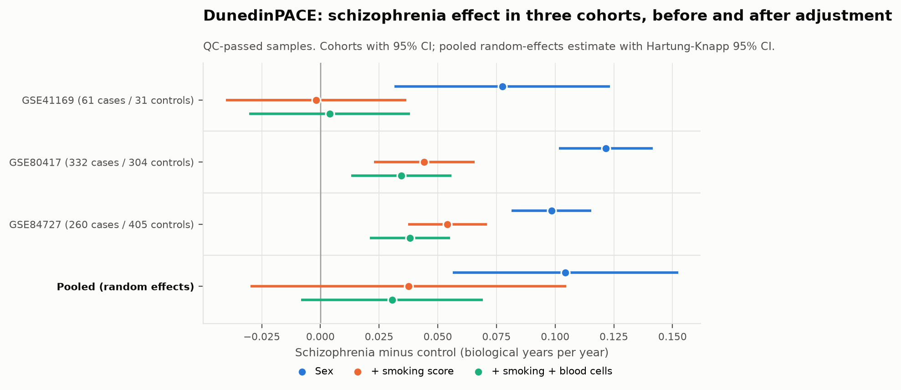

# 1. Epigenetic clocks in three schizophrenia cohorts

## Summary

Six published epigenetic clocks were run on three public whole-blood cohorts: 1,396 people with or without schizophrenia, a condition that shortens life by 10 years or more.

- **The clocks disagree, and how they were trained decides what they see.** Clocks trained on chronological age show no consistent difference. GrimAge2, trained on time to death, and DunedinPACE, trained on the pace of physiological decline, show faster ageing in schizophrenia in every cohort. Pooled, cases are 4.8 years older on GrimAge2 and age 0.10 biological years per year faster on DunedinPACE (both p ≈ 0.01).
- **Most of that is smoking.** Adjusting for a methylation smoking score removes three quarters or more of the GrimAge2 effect in every cohort, and what remains changes sign between cohorts.
- **DunedinPACE keeps a residual effect in both large cohorts** after adjusting for smoking and blood cells (+0.034 and +0.038, p = 0.002 and p < 10⁻⁴), as Caspi et al. (2024) and Shirai et al. (2024) report. The small, young cohort sits at zero, and with three cohorts that disagreement puts the pooled interval across zero.
- **Combining three differently processed public datasets took work:** a loader for betas that GEO keeps outside the series matrix, two impossible ages, and one cohort deposited without 65,000 probes. Those missing probes shrink the unadjusted effect by a fifth to a third but leave the smoking-adjusted effect unchanged.

## Question

Epigenetic clocks are often treated as interchangeable measures of "biological age". Where do they agree, and which of them register a condition known to shorten life? Schizophrenia is a demanding test: people with schizophrenia smoke far more than average, so a clock can show faster ageing because it measures smoking.

## Data

| | GSE41169 | GSE80417 | GSE84727 |
| --- | --- | --- | --- |
| Source | Utrecht | University College London | Aberdeen |
| Analysed: cases / controls | 62 / 33 | 332 / 304 | 260 / 405 |
| Median age: controls / cases | 27 / 31.5 | 31 / 42 | 46 / 43 |
| Male: controls / cases | 64% / 74% | 44% / 73% | 75% / 68% |
| Smoking score: controls / cases | 3.1 / 4.4 | 3.6 / 4.9 | 3.7 / 4.5 |
| Probes | 485,577 | 483,636 | 420,374, none on X or Y |

All three are whole blood on the Illumina 450K array. GSE80417 and GSE84727 come from Hannon et al. (2016). The analysed numbers for those two match Shirai et al.'s exactly, so the two analyses use the same samples. The cohorts differ in ways that matter: GSE80417's cases are 11 years older and far more often male than its controls, while GSE84727 is balanced for age and sex.

## Methods

- **Clocks:** Horvath and Hannum (trained on chronological age), PhenoAge (a clinical phenotype), GrimAge2 (time to death), DunedinPACE (pace of decline, in biological years per calendar year) and CausAge (CpGs with putative causal links to ageing), all run with Biolearn.
- **Age deviation:** the residual of each clock regressed on chronological age, within each cohort. It removes each clock's offset and bias, so deviations are comparable across clocks.
- **Group comparison:** case minus control in age deviation, from linear models with three nested sets of covariates:
  1. sex;
  2. plus a methylation smoking score (McCartney);
  3. plus estimated B cell, CD4 and CD8 T cell and monocyte proportions.
- **Quality control:**
  - **Sex check.** Methylation-predicted sex against recorded sex. In GSE41169 two samples did not match, and in GSE80417 none did.
  - **Outlier.** GSM1009696 in GSE41169 was also excluded. Four clocks put it 14–21 years below its recorded age.
  - Results are reported for all samples and for QC-passed samples; this document quotes QC-passed results.
- **Pooling:** random-effects meta-analysis (DerSimonian and Laird 1986). With three studies of very unequal size, the usual normal-approximation interval is too narrow, so the Hartung–Knapp interval was chosen in advance (IntHout et al. 2014). It uses a t distribution with 2 degrees of freedom and is about 2.2 times wider.

## Harmonising three public datasets

- **The betas are not in the GEO series matrix.** For GSE80417 and GSE84727 the series matrix holds metadata only. The normalised betas are in a 2.4–2.7 GB supplementary file whose columns are Sentrix chip positions. The loader maps chip positions to GEO sample IDs and stops if any sample fails to match. The disease label comes from each sample's source name and must agree exactly with the numeric code, which it does in both cohorts.
- **Ages:**
  - 37 samples in GSE80417 and 182 in GSE84727 have no recorded age, and are dropped.
  - Two more in GSE80417 are recorded as 891 and 883 years old. A single such value flattens every age regression in a cohort: in a first run it made all six clocks show cases as several years "older". Ages outside 0–110 are now treated as missing.
  - In GSE84727 the missing ages are not random: 154 of 414 cases lack one, against 28 of 433 controls.
- **GSE84727 was deposited without about 65,000 probes,** including every probe on the sex chromosomes:

  | Model | Its CpGs present in GSE84727 |
  | --- | --- |
  | Horvath, Hannum, PhenoAge | 96–99% |
  | CausAge | 93% |
  | DunedinPACE | 86% |
  | GrimAge2 | 82% |
  | Smoking score, blood-cell reference | 95%, 92% |

  The sex check is impossible there. In GSE80417 only 24% of the sex estimator's Y probes are present, but X is complete and the check still works.
- **Filling missing CpGs.** Biolearn's default fills only missing values of CpGs that are present. A CpG absent altogether makes the linear clocks fail and GrimAge2 silently compute without it. Every cohort is therefore run with Biolearn's 450K reference medians filling absent CpGs.

## Findings

Effects are case minus control in each clock's own units, QC-passed samples.

### 1. The clocks track age to very different degrees

| Clock | Pearson r with age | Mean absolute error, years |
| --- | --- | --- |
| Horvath | 0.93–0.94 | 3.0–5.0 |
| Hannum | 0.93–0.95 | 3.1–7.8 |
| PhenoAge | 0.91 | 4.4–5.6 |
| CausAge | 0.92–0.95 | 4.7–6.8 |
| GrimAge2 | 0.85–0.91 | 14.6–16.2, all overshoot |
| DunedinPACE | 0.28–0.50 | not applicable: a rate |

Ranges are across the three cohorts. GrimAge2 overestimates age by about 15 years in every cohort. DunedinPACE is not meant to track age. Tracking age closely is not the goal of an ageing biomarker: Moqri et al. (2023) call this the "paradox of biomarkers". The residual-based comparisons are unaffected by these offsets.

### 2. Before smoking adjustment, every cohort shows faster ageing on GrimAge2 and DunedinPACE

| Clock, adjusted for sex | GSE41169 | GSE80417 | GSE84727 |
| --- | --- | --- | --- |
| GrimAge2, years | +4.55 (p = 0.0004) | +5.62 (p < 10⁻⁴⁰) | +4.16 (p < 10⁻³⁰) |
| DunedinPACE | +0.077 (p = 0.001) | +0.122 (p < 10⁻²⁹) | +0.098 (p < 10⁻²⁶) |
| Horvath, years | −1.42 | −0.82 | −0.22 |
| PhenoAge, years | −0.23 | +1.26 | +1.48 |

The effects of GrimAge2 and DunedinPACE are large: Cohen's d 0.79–1.30 and 0.68–0.97. Horvath is never positive. Hannum, PhenoAge and CausAge are modestly raised in GSE84727 (+0.75, +1.48 and +0.87 years; p = 0.003, 0.0002 and 0.001), and PhenoAge in GSE80417. These effects shrink and lose significance after blood-cell adjustment, and none survives pooling.

### 3. After adjustment, only DunedinPACE keeps a consistent residual

| | GSE41169 | GSE80417 | GSE84727 |
| --- | --- | --- | --- |
| GrimAge2 + smoking | −1.00 (p = 0.13) | +0.63 (p = 0.03) | +1.08 (p < 10⁻⁵) |
| GrimAge2 + smoking + cells | −0.67 (p = 0.29) | +0.24 (p = 0.40) | +0.55 (p = 0.012) |
| DunedinPACE + smoking | 0.00 (p = 0.92) | +0.044 (p = 10⁻⁴) | +0.054 (p < 10⁻⁹) |
| DunedinPACE + smoking + cells | 0.00 (p = 0.82) | +0.034 (p = 0.002) | +0.038 (p < 10⁻⁴) |

- **GrimAge2's signal is mostly smoking.** Smoking adjustment removes 89% of the effect in GSE80417, 74% in GSE84727 and all of it in GSE41169. What remains is small and changes sign between cohorts.
- **DunedinPACE keeps a residual of about +0.04 in both large cohorts.** In GSE80417 the smoking-adjusted effect is 0.32 SD of age deviation. Shirai et al. standardised both the outcome and the case indicator; for a near-balanced cohort their coefficient is about half the difference in SD units, so their 0.17–0.22 in the large cohorts corresponds to roughly 0.35–0.45 SD, close to this.

### 4. Pooled across the three cohorts

| Clock | Sex only | + smoking | + smoking + cells |
| --- | --- | --- | --- |
| GrimAge2, years | **+4.82** (2.75 to 6.90), p = 0.010 | +0.45 (−1.99 to 2.88), p = 0.51, I² 79% | +0.27 (−0.93 to 1.47), p = 0.44 |
| DunedinPACE | **+0.104** (0.056 to 0.152), p = 0.011 | +0.038 (−0.030 to 0.105), p = 0.14, I² 71% | +0.031 (−0.008 to 0.069), p = 0.08 |
| Horvath, years | −0.58 (−1.84 to 0.67), p = 0.18 | −0.15 | −0.12 |
| PhenoAge, years | +1.20 (−0.38 to 2.79), p = 0.08 | +0.65 | +0.06 |

Random-effects estimates with Hartung–Knapp 95% intervals and p-values.

- **Faster ageing on GrimAge2 and DunedinPACE is robust before smoking adjustment.** The intervals exclude zero even with the conservative method.
- **The residual DunedinPACE effect cannot be pooled with confidence.** The two large cohorts agree, but GSE41169 sits at zero, and the disagreement is larger than chance (Cochran's Q p = 0.03). With the normal approximation the pooled residual would be significant (p = 0.004, and p = 0.0003 with cells), but switching methods after seeing the result would be choosing the answer.
- **Why GSE41169 might differ.** It is the youngest cohort (median 29, against 37 and 46), and Caspi et al. describe accelerated ageing in schizophrenia as appearing by midlife. With one small cohort this is a hypothesis.

### 5. What GSE84727's missing probes do to the clocks

To check whether GSE84727 can be compared with the other cohorts, the other two were rerun on GSE84727's probes, with the missing CpGs filled in the same way.

| | GSE41169 | GSE80417 |
| --- | --- | --- |
| Correlation, all probes vs restricted: GrimAge2 / DunedinPACE | 0.99 / 0.98 | 1.00 / 0.98 |
| Spread of age deviation, restricted vs all: GrimAge2 / DunedinPACE | 0.81 / 0.84 | 0.84 / 0.89 |
| GrimAge2 effect, sex only, SD units: all → restricted | 0.76 → 0.55 | 1.01 → 0.82 |
| DunedinPACE effect, sex only | 0.70 → 0.46 | 0.89 → 0.74 |
| GrimAge2 effect, + smoking | −0.17 → −0.19 | 0.11 → 0.11 |
| DunedinPACE effect, + smoking | −0.02 → −0.02 | 0.32 → 0.38 |

Effects are in SD units of the all-probe age deviation, so any shrinkage shows.

- **The estimates barely change, but their spread does.** Filling missing CpGs with a constant reduces how much people differ on GrimAge2 and DunedinPACE by 11–19%.
- **That shrinks the unadjusted schizophrenia effect by 17–34%, but not the smoking-adjusted one.** One explanation is that the lost CpGs carry part of the smoking-related signal; which CpGs they are has not been tested.
- **For the pooled analysis:** GSE84727's sex-only effects are underestimates, so the sex-only pooled estimates are conservative. Its smoking-adjusted effects are comparable with the other cohorts.

## How this compares with the literature

- **Clocks trained on chronological age** show no acceleration in schizophrenia in larger studies (McKinney et al. 2017) and, if anything, slower ageing (Wu et al. 2021).
- **Mortality clocks** run up to 5 years older in schizophrenia, largely because of smoking and smoking-related protein surrogates (Higgins-Chen et al. 2020).
- **Shirai et al. (2024)** meta-analysed seven cohorts, including all three used here. For GSE41169 alone they too found no effect after smoking adjustment on GrimAge2 (standardised β = −0.001, p = 0.98) or DunedinPACE (β = 0.016, p = 0.80). In the large cohorts both stayed elevated.
- **Caspi et al. (2024)** pooled five cohorts and 3,565 people. Their unadjusted DunedinPACE effect was 0.65 SD, and 0.22 SD remained after adjusting for cells and smoking.

## Why the clocks disagree

What a clock was trained to predict decides what it sees:

- **Horvath and Hannum** learned chronological age, so they capture little of the variation that matters for health.
- **GrimAge2** learned time to death through surrogates of plasma proteins and smoking pack-years. It reacts strongly to smoking, the exposure that differs most between these groups.
- **DunedinPACE** learned the pace of physiological decline. It is less tied to smoking, which fits a residual effect after adjustment.

Smoking is probably part of the path from schizophrenia to faster ageing, not only a nuisance variable. What these data show is how much of the clock signal smoking accounts for, not that the rest is free of it.

## Limitations

- **Three cohorts.** The pooled intervals are wide, and three cohorts cannot explain their heterogeneity.
- **Smoking is estimated from methylation.** It likely shares CpGs with GrimAge's own smoking component, and different proxies (McCartney here, Elliott in Caspi, DNAmPACKYRS in Shirai) remove different amounts of signal.
- **Missing ages in GSE84727 are concentrated in cases** (37% of cases, 7% of controls). If missingness relates to illness severity or recruitment site, the analysed cases are not representative.
- **No sex check in GSE84727,** because its sex-chromosome probes were removed before deposit.
- **Different processing.** GSE41169 comes from the GEO series matrix; the other two are the submitters' normalised betas. The probe-set test covers missing probes, not differences in normalisation.
- **Blood mainly reports immune ageing,** and cell-proportion adjustment may remove genuine ageing signal along with confounding.

## Next

- **Integrate the cohorts with mixOmics MINT** on the CpGs all three share: the same omic across several studies.
- **Add a fourth large cohort,** such as Shirai et al.'s Dublin cohort from the same consortium. It would narrow the pooled interval more than anything else.
- **Compare smoking proxies directly,** and see how much each removes.

## References

- Moqri M, et al. (2023) Biomarkers of aging for the identification and evaluation of longevity interventions. *Cell* 186:3758–3775. [doi:10.1016/j.cell.2023.08.003](https://doi.org/10.1016/j.cell.2023.08.003)
- Hannon E, et al. (2016) An integrated genetic-epigenetic analysis of schizophrenia: evidence for co-localization of genetic associations and differential DNA methylation. *Genome Biology* 17:176. [doi:10.1186/s13059-016-1041-x](https://doi.org/10.1186/s13059-016-1041-x)
- Shirai T, et al. (2024) Meta-analyses of epigenetic age acceleration and GrimAge components of schizophrenia or first-episode psychosis. *Schizophrenia* 10:108. [doi:10.1038/s41537-024-00531-8](https://doi.org/10.1038/s41537-024-00531-8)
- Caspi A, et al. (2024) Accelerated pace of aging in schizophrenia: five case-control studies. *Biological Psychiatry* 95(11):1038–1047. [doi:10.1016/j.biopsych.2023.10.023](https://doi.org/10.1016/j.biopsych.2023.10.023)
- Higgins-Chen AT, et al. (2020) Schizophrenia and epigenetic aging biomarkers: increased mortality, reduced cancer risk, and unique clozapine effects. *Biological Psychiatry*. [doi:10.1016/j.biopsych.2020.01.025](https://doi.org/10.1016/j.biopsych.2020.01.025)
- McKinney BC, et al. (2017) DNA methylation age is not accelerated in brain or blood of subjects with schizophrenia. *Schizophrenia Research*. [doi:10.1016/j.schres.2017.09.025](https://doi.org/10.1016/j.schres.2017.09.025)
- Wu X, et al. (2021) Epigenetic age acceleration was delayed in schizophrenia. *Schizophrenia Bulletin*. [doi:10.1093/schbul/sbaa164](https://doi.org/10.1093/schbul/sbaa164)
- DerSimonian R, Laird N (1986) Meta-analysis in clinical trials. *Controlled Clinical Trials* 7:177–188. [doi:10.1016/0197-2456(86)90046-2](https://doi.org/10.1016/0197-2456(86)90046-2)
- IntHout J, Ioannidis JPA, Borm GF (2014) The Hartung-Knapp-Sidik-Jonkman method for random effects meta-analysis is straightforward and considerably outperforms the standard DerSimonian-Laird method. *BMC Medical Research Methodology* 14:25. [doi:10.1186/1471-2288-14-25](https://doi.org/10.1186/1471-2288-14-25)
