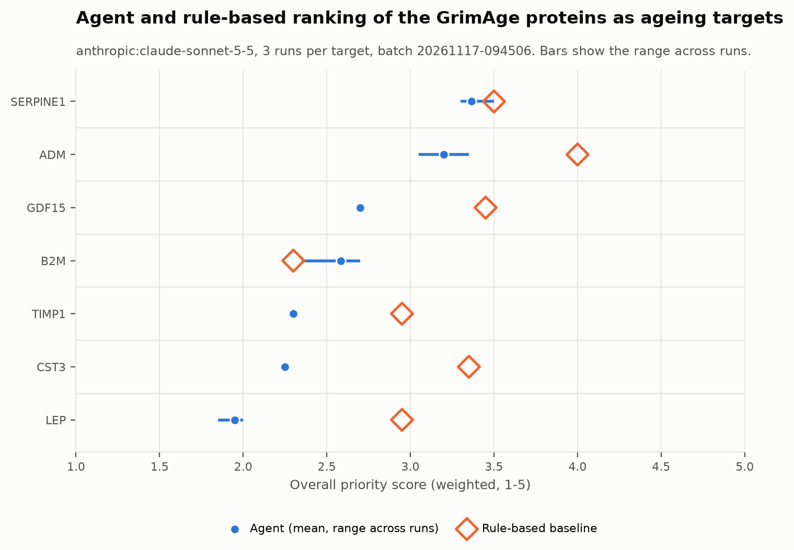

# 2. Target triage: an LLM agent with its work checked in code

## Summary

GrimAge2, the clock most associated with schizophrenia in [part 1](1-clocks.md), is built from methylation surrogates of seven plasma proteins: ADM, B2M, cystatin C (CST3), GDF15, leptin (LEP), PAI-1 (SERPINE1) and TIMP1. An LLM agent assessed them as candidate targets for healthy ageing. It scored each on five dimensions from cached public evidence and the Mendelian randomisation results of [part 3](3-causal-direction.md), citing the facts behind every score.

- **264 of 265 cited facts match the evidence the agent was shown.** The one mismatch reformatted a list of MR results into one line, with correct values.
- **PAI-1 ranks first,** the only protein with a proposed direction (inhibit) and the only one recommended for prioritisation, in two of three runs. ADM is second and GDF15 third.
- **The top three hold under almost any weighting of the scores, but first place is a trade-off.** PAI-1 leads on evidence about ageing, ADM on evidence about drugs. Near the chosen weights PAI-1 stays first in 89% of reweightings; across every possible weighting it is close to a coin flip.

## Design

The agent does the one task code cannot do, weighing incomplete evidence. Everything around it is deterministic:

1. **Evidence, without an LLM.** For each protein:
   - Open Targets: tractability, safety liabilities, clinical candidates, disease associations;
   - UniProt: function and location;
   - Europe PMC: publication counts, searched by curated protein names, because symbols such as "ADM" and "LEP" are ambiguous;
   - the MR results from part 3, as facts.

   Responses are cached as JSON and flattened into facts with stable IDs, such as `clinical.max_stage = 2`, so every run and every model sees identical evidence.
2. **The agent** reads the facts through eight tools and submits a fixed-format assessment:
   - five scores from 1 to 5, each with a rationale and the fact IDs and values it relies on;
   - claims from its own knowledge, listed separately;
   - conflicts between sources, and which source it relied on;
   - a proposed modulation (inhibit, activate or unclear) and a recommendation (prioritise, consider or deprioritise).

   A submission that breaks the format is rejected and returned with the reasons.
3. **Checks, in code:**
   - every cited value is compared with the facts that run was shown, read back from its saved trace;
   - the scores are compared with a rule-based baseline;
   - each protein is assessed three times, to measure run-to-run variation;
   - the ranking is recomputed under 20,000 other weightings.
4. **The report** (`results/targets/report.md`) is assembled by code from the structured assessments, so no unchecked text is added after the checks.

The agent works with Anthropic, OpenAI or a local model through Ollama. The results here come from Claude Sonnet.

## The rubric

| Dimension | Weight | 5 means | Baseline rule |
| --- | --- | --- | --- |
| Ageing relevance | 0.30 | strong, multi-source evidence of involvement in human ageing | share of the protein's papers on ageing or senescence, ranked against the other candidates, plus age-related disease associations |
| Mechanism | 0.15 | well understood, with a clear direction of modulation | 1 + annotated function + secreted + any age-related disease link, at most 4 |
| Tractability | 0.20 | approved-drug precedence | best Open Targets tractability label across modalities |
| Safety | 0.20 | no known liabilities and benign biology; capped at 4 without data | 4 with no liabilities, lower with more |
| Clinical precedence | 0.15 | approved drug; 4 = phase 3, 3 = phase 2, 2 = phase 1 | 1 + the highest clinical stage |

The share of papers measures relevance; a raw count would measure how popular a protein is. The overall score is the weighted sum, computed in code. The baseline is deliberately crude: a reference point, not the answer.

## Results

| Rank | Protein | Agent score, mean (range over 3 runs) | Baseline | Recommendations | Modulation |
| --- | --- | --- | --- | --- | --- |
| 1 | SERPINE1 (PAI-1) | 3.37 (3.30–3.50) | 3.50 | prioritise 2, consider 1 | inhibit |
| 2 | ADM | 3.20 (3.05–3.35) | 4.00 | consider 3 | unclear |
| 3 | GDF15 | 2.70 | 3.45 | consider 3 | unclear |
| 4 | B2M | 2.58 (2.35–2.70) | 2.30 | consider 3 | unclear |
| 5 | TIMP1 | 2.30 | 2.95 | deprioritise 2, consider 1 | unclear |
| 6 | CST3 (cystatin C) | 2.25 | 3.35 | deprioritise 3 | unclear |
| 7 | LEP (leptin) | 1.95 (1.85–2.00) | 2.95 | deprioritise 3 | unclear |

- **The runs worked.** All 21 completed in two or three turns and every run used all eight tools. Each flagged up to three conflicts between sources.
- **Evidence and the model's own knowledge stayed separate.** The agent named drugs it knew of that the tools did not list and did not score them: ponsegromab, an anti-GDF15 antibody, and metreleptin, which replaces leptin rather than acting on it. It discounted PROTAC evidence for secreted proteins.
- **It was stricter on safety than the baseline.** It followed the rule that no recorded liabilities is absence of data, not evidence of safety.
- **Scores were stable within the batch;** no protein's overall score varied by more than 0.35 across runs. Recommendations varied for PAI-1 and TIMP1.
- **Where the agent and the baseline differ, it is on judgement.** They agree on tractability, safety ranking and clinical precedence (Spearman ρ 0.90–1.00), the dimensions that follow directly from database fields. They do not agree on ageing relevance (ρ = 0.00) or mechanism (ρ = 0.21), where the agent weighs literature, context and causal evidence that fixed rules cannot.
- **An unchecked claim was right, but unchecked.** The agent wrote that GDF15's genetic instruments disagree with each other without citing a fact for it. It was correct (see part 3), but rationale text is only partly verified.

## How much the ranking depends on the weights

The weights are a judgement, not fitted: seven unlabelled proteins give nothing to fit them to. Instead the ranking was recomputed for 20,000 random weightings, first with each weight varying by about ±0.05 around the chosen values, then with every possible weighting equally likely.

| | Near the chosen weights | Any weighting |
| --- | --- | --- |
| SERPINE1 ranks first | 89% | 56% |
| ADM ranks first | 11% | 44% |
| Top three is SERPINE1, ADM and GDF15 | 100% | 99% |

- **The top three do not depend on the weights.** GDF15 scores at least as high as B2M, TIMP1, CST3 and LEP on every dimension, so no weighting can rank it below them.
- **First place is a trade-off between two kinds of evidence.** SERPINE1 leads on ageing relevance (+1.0) and mechanism (+1.3); ADM leads on clinical precedence (+1.3) and safety (+0.7). SERPINE1 is first because the rubric weights evidence about ageing above evidence about drugs. That suits target discovery, but it is a choice, and this is what it decides.
- **The agent was inconsistent on exactly this dimension.** All three runs read the same fact, that the antibody enibarcimab has reached phase 2/3, but scored ADM's clinical precedence 3, 4 and 3. The rubric defines phase 2 and phase 3 but not phase 2/3; the baseline treats it as phase 3. Defining it would remove the one run-to-run difference that bears on first place.

## Limitations

- **The seven proteins were not discovered by the agent.** They come from a published clock, so this tests annotation and triage, not discovery.
- **The evidence is narrow:** three public databases, a sparse safety dataset, and MR for five of seven proteins.
- **Prose is only partly checked.** Cited values are verified; whether a sentence fairly represents a fact is not.
- **The recommendation is not derived from the score.** The agent chooses it separately, which lets it weigh how decisive one piece of evidence is, but also means the two could disagree.
- **One model.** The workflow is provider-agnostic, but the assessments come from one model.

## Next

- **Define phase 2/3 in the rubric,** and rerun to see whether ADM's clinical precedence stabilises.
- **Run a second model** on the same evidence and compare rankings and citation accuracy.
- **Scale up:** cis-MR for every protein with instruments, fixed rules in code to narrow to 50–200, then the agent. The seven GrimAge proteins tested the workflow; a proteome-wide screen is where it would find new targets.

How the agent's instructions evolved, and what went wrong along the way, is in the [development notes](development-notes.md).
